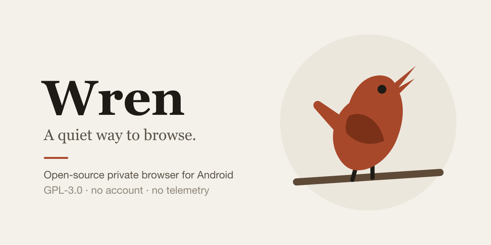
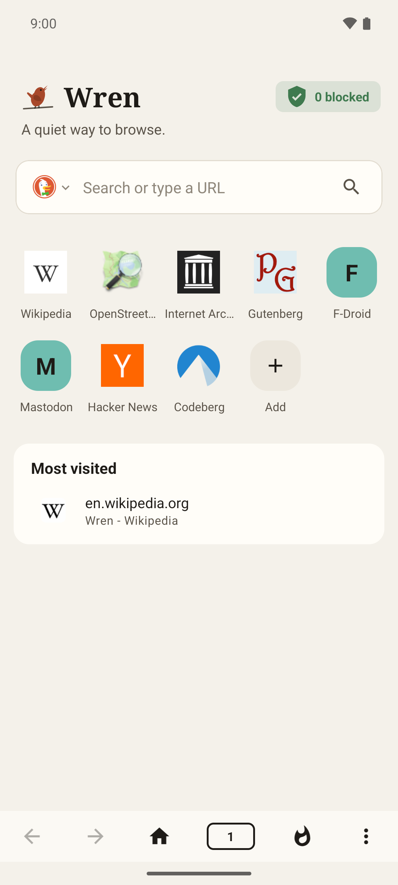
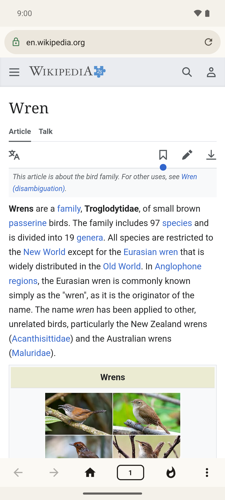
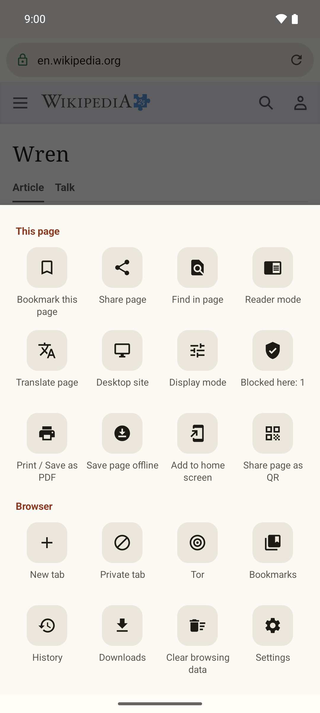
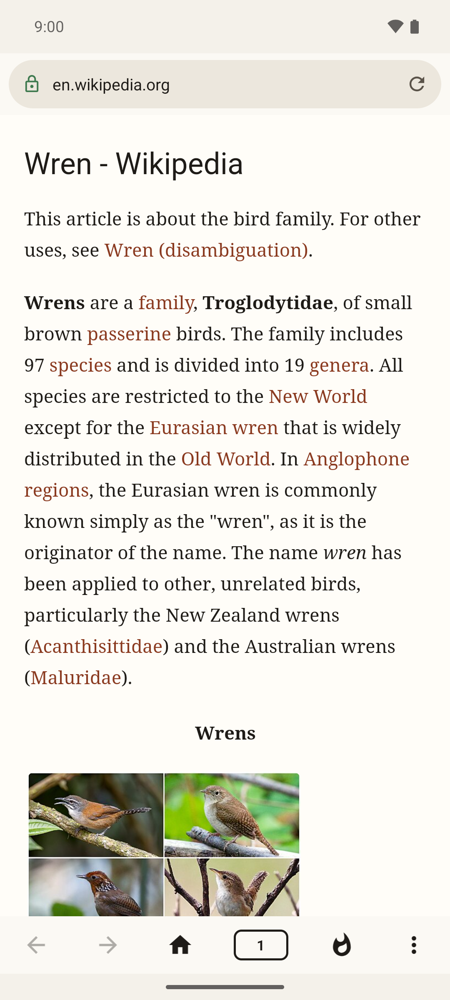
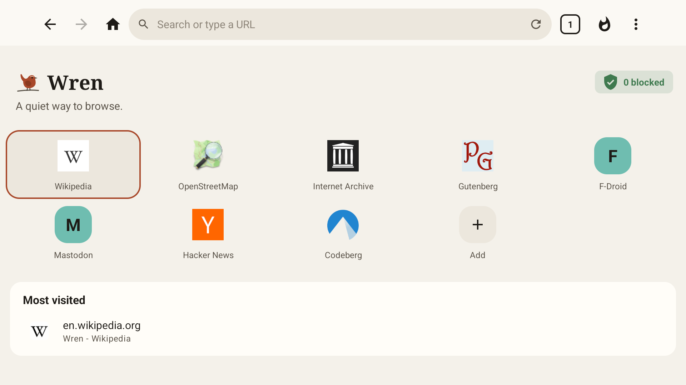
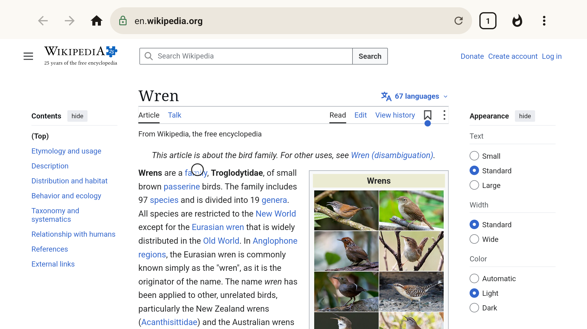
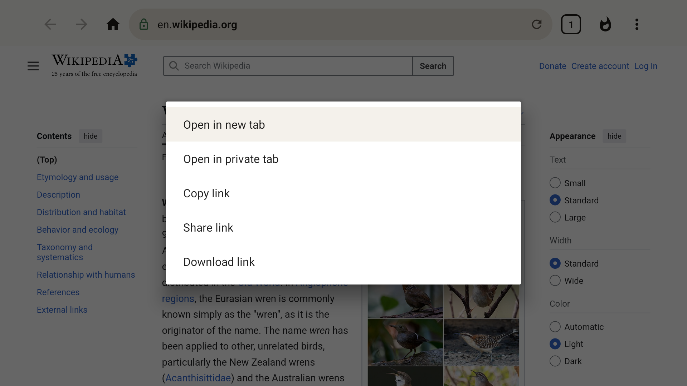

<p align="center">
  
</p>

<p align="center">
  <a href="https://github.com/AndroidPoet/Wren/actions/workflows/ci.yml"></a>
  <a href="LICENSE"></a>
  
</p>

<p align="center">
  A private Android browser that blocks trackers and ads out of the box.<br>
  No account. No telemetry. No servers of its own.
</p>

<p align="center">
  
  
  
  
</p>

## Features

**Blocking**
- Tracker and ad blocking with EasyList, EasyPrivacy and uBlock Origin rules, compiled into a
  pattern engine with cosmetic filtering and scriptlets. Lists update from Settings, and you can
  add your own.
- A per-site panel showing what was blocked, grouped by the company that owns it.
- Cookie banners declined and hidden on common consent platforms.

**Privacy**
- **Clear everything**: one tap closes every tab and deletes history, cookies and cache, with an
  optional wipe on exit.
- **Private tabs** on their own WebView profile: no history, cookies or cache written; WebRTC,
  motion sensors, device lists and WebGPU removed; keyboard learning off. On an engine that
  cannot give them a profile they get no network rather than the normal tabs' cookies.
- **Tor mode** through the Guardian Project's tor-android, with obfs4, Snowflake and meek bridges
  (Tor Browser's built-in ones, or your own lines) for networks that block Tor.
- **App lock** using the device's own screen lock.
- HTTPS upgrade and an HTTPS-only mode, tracking parameters stripped from links, bounce
  redirectors and AMP cache links unwrapped, fingerprinting and WebRTC leak protection with
  noise that is stable per site, third-party cookies blocked and third-party frames denied every
  other kind of storage (the engine blocks the cookie but not the frame's localStorage, IndexedDB,
  caches or files, which join two sites the same way), Attribution Reporting off, `DNT`
  and Global Privacy Control exposed to pages, form data never saved, location and camera/mic
  requests denied.
- Mixed content blocked: an encrypted page loads nothing over plain HTTP. Internet pages are kept
  off the phone's own network (`localhost`, `192.168.x.x` and the other private ranges), link
  `ping` trackers are removed as the link is tapped, certificate errors are never clicked
  through, and the engine's media-integrity API, which would name the app to a site, is off.

**Browsing**
- DuckDuckGo by default; Brave, Startpage, Mojeek, Wikipedia and Google available. `!bangs` work
  in the address bar.
- Tabs, history, bookmarks, downloads, reader mode, find in page, desktop mode and QR sharing.
- Downloads go through the system download manager; in Tor mode they run inside Wren through
  Tor, with a notification, pause and resume.

## What leaves your phone

Wren has no backend. The only network traffic is:

| Traffic | When |
| --- | --- |
| The pages you open | Always |
| Search suggestions from your chosen engine | Only if turned on in Settings, then while typing |
| Filter-list downloads | Shortly after launch when a list is over a week old (so also on first launch), or when you tap Update now in Settings |
| Speed-dial site icons | Can be turned off |
| Safe Browsing checks (hashed address prefixes, to Google through Android) | Unless turned off in Settings; always off in Tor mode |
| Passkey sign-ins, through your phone's password manager | Only when a site asks you to sign in with one |
| Tor | Only if you turn it on |

Addresses are looked up with your phone's own DNS. To encrypt those lookups, turn on Private DNS
in Android's network settings; in Tor mode, lookups go through Tor instead. The full
[privacy policy](PRIVACY.md) lists the same.

## What Wren is not

Wren is a shell around Android's system WebView, which is Chromium shipped and updated by Google
or your phone maker. Wren decides what is loaded and where it goes; it does not control the
engine. Before relying on it for anything sensitive, know the limits:

- **The engine is the system's.** Its version, security patches, site isolation, JIT, storage
  partitioning and WebRTC internals come from the system WebView, not from Wren. Wren warns when
  the engine is out of date, but only you can update it.
- **Tor mode is not Tor Browser.** It sends every tab and every request the app makes through
  Tor, keeps Tor pages in a storage profile of their own that is thrown away when Tor is turned
  off, writes nothing they visit to history, gives each destination host its own circuit,
  refuses plain HTTP, runs downloads itself through Tor, removes WebRTC and the motion sensors
  from pages, forces third-party cookies off, shows pages a UTC clock on a 100 ms grid and
  answers in English, letterboxes every page to 100 px steps and reports the screen as that
  viewport, and asks the keyboard not to learn from what is typed. A Safest switch on the Tor
  sheet turns JavaScript off and blocks web fonts on every Tor page. Under Tor the canvas reads
  back blank, as in Tor Browser, so every Tor user gives the same answer; outside Tor
  fingerprint protection gives each site its own noise, the same for that site until you clear
  browsing data or restart Wren, with separate noise for normal, private and Tor pages. The
  fonts installed on the phone stay visible. Turning Tor on closes the pages that were open
  rather than reloading them over Tor, because the same address fetched on both routes would
  tie the Tor session to the one your network saw. Tor Browser isolates circuits by the site you are
  on; a WebView cannot, so Wren isolates them by the host being fetched. New identity closes
  every tab, deletes the Tor profile, moves the tunnel so no old connection survives, and asks
  Tor for new circuits. Web Workers are started from a bootstrap that installs the clock, canvas
  and locale shims before the page's script runs in them. If Tor fails to connect, Wren points every tab at a
  closed port rather than falling back to the open network. Bridges run through Lyrebird,
  Tor Browser's pluggable-transport binary; before the first byte goes through Tor, meek
  reaches its content-delivery front over the open network, and Snowflake its front, a STUN
  server from the bridge line and a volunteer's WebRTC proxy, as in Tor Browser. Downloads,
  site icons and filter-list updates use a client of Wren's own that refuses, under Tor, any
  connection that is not the tunnel: Android's built-in HTTP client silently falls back to a
  direct connection when a proxy fails, so it is not used anywhere.
- **One DNS lookup escapes Tor.** When a page asks the engine to look up a host ahead of time
  (`<link rel="dns-prefetch">`), Chromium's WebView resolves it through the phone's DNS, not
  through the proxy, and offers apps no switch for it. A page can use that to learn which
  resolver, and so roughly which network, a Tor visitor is on. Tor over a VPN, or a private DNS
  server, moves that disclosure from your ISP to that provider; nothing in Wren can close it.
- **The engine names the app.** Android's WebView adds an `X-Requested-With: dev.androidpoet.wren`
  header to the requests pages make, and no app can turn that off: Chromium ended the trial
  that was to remove it, and androidx.webkit now documents the allow-list API that was meant
  to control it as doing nothing. Wren strips it from the page request itself, but images,
  scripts and fetches still carry it, so a site can tell it is talking to Wren. The user agent
  and client hints are Chrome's reduced ones (`Android 10; K`, no device model or build), so
  the phone itself is not named.
- **Safe Browsing talks to Google.** Short hashed prefixes of addresses go to Google through
  Android. It is off in Tor mode and can be turned off in Settings.
- **The privacy signal headers need a recent engine.** Pages can always read Global Privacy
  Control and Do Not Track from JavaScript. As `Sec-GPC` and `DNT` request headers they ride on
  every request only where the WebView lets an app add a header per profile, which Chromium
  shipped in WebView 142 (October 2025); on an older engine only the page loads started from
  the address bar carry them, so a site that reads just the header does not see them there.
- **Nobody independent has audited Wren.** The source is public and reviews of it are
  welcome, but reading the source shows what Wren intends to do, not that it is safe against a
  determined adversary.

If your safety depends on being anonymous, use [Tor Browser for
Android](https://www.torproject.org/download/#android). Wren is for everyday browsing with
trackers and ads out of the way.

## Android TV

<p align="center">
  
  
  
</p>

Wren appears in the Android TV launcher and is driven by the remote. The D-pad moves a cursor
over the page: a tap is a step, a held key accelerates, the centre key presses where the cursor
points and a held centre key is a long press. At an edge the cursor scrolls the page; pushed off
the top of a page that is already at its top it moves into the address bar, from where Down
returns to the page. On the home page the D-pad moves between the tiles instead. The chrome is
one row at the top of the screen and sites get their desktop layout. Tor mode works the same as
on a phone when the TV's WebView supports profiles (it fails closed, with no network, when it
does not).

The microphone button in that row searches by voice. The listening is done by the TV's own speech
recogniser, a separate app, so Wren itself still asks for no microphone permission; because that
app is outside Wren and outside Tor, the button is absent in Tor mode and in private tabs, and on
a TV that has no recogniser. The remote's Play, Pause, Fast-forward and Rewind keys act on the
page's video: the fullscreen one, else the one that is playing, else the largest. A player inside
a frame from another site cannot be reached that way, so press it with the cursor. Menus and
sheets open at full height, and in the tab switcher Up from a tab reaches its close button.

## Download

Get the APK for your phone from [Releases](https://github.com/AndroidPoet/Wren/releases/latest):
`arm64-v8a` for most phones, or `universal` if you are not sure. Or build it from source (below).
[Obtainium](https://github.com/ImranR98/Obtainium) can watch that page and install updates for you.

**Check what you installed.** Every release ships a `SHA256SUMS` file, and every APK is signed
with this certificate:

```
CN=AndroidPoet, O=AndroidPoet
SHA-256: AD:76:AB:B2:F4:C5:4A:A9:E9:A9:9E:FA:F9:1F:AD:2B:2B:37:98:CF:87:26:5E:C2:DA:39:2C:57:B2:C8:C7:CE
```

Compare it after installing with [AppVerifier](https://github.com/soupslurpr/AppVerifier), or
before installing with `apksigner verify --print-certs wren-*.apk`. Android refuses an update
over Wren unless it is signed with this same key, so one checked install covers the ones after it.

## Build

```bash
./gradlew :app:assembleDebug     # build
./gradlew testDebugUnitTest      # unit tests
./gradlew spotlessApply          # format + license headers
```

Requires JDK 17+ (Android Studio's JBR works) and `compileSdk 37`. `minSdk` is 24.

## How it works

<details>
<summary>Module layout</summary>

| Module | Contains |
| --- | --- |
| `app` | Browser UI, tab management, WebView policy, settings |
| `core-model` | `HistoryEntry`, `Bookmark`, `Suggestion`, `SearchEngine`, `TabSnapshot` |
| `core-network` | Retrofit client for search-engine autocomplete |
| `core-database` | Room database, DAOs and entity mappers for history and bookmarks |
| `core-data` | Repositories that join network and database |
| `core-test` | Shared test fixtures |
| `benchmark` | Macrobenchmark / baseline profile generation |

`core-*` modules never depend on `app`; `app` talks only to `core-data`.

</details>

<details>
<summary>Design notes</summary>

**A small pool of live tabs.** Up to four tabs keep a live `WebView`; the rest are held as saved
state (`TabManager`). A tab still in the pool switches instantly and keeps loading, playing and
running while another is on screen; one that has aged out costs a re-render when it comes back.
Memory therefore tracks the pool, not the tab count, and under `onTrimMemory` the pool collapses
to the active tab alone. Low-RAM devices keep one, which is what every device used to do.

**Suggestions emit twice.** `SuggestionRepository` emits local history matches immediately, then
re-emits widened with remote results. The omnibox stays responsive when the network is slow, and
degrades to history-only when it is absent or disabled.

**History is per-URL, not per-visit.** One row per page with `visitCount` and `lastVisitedAt`; a
row-per-load table grows without bound and the omnibox only needs "when last" and "how often".
The speed dial folds those rows by host, so a site that redirects, challenges and lands still
occupies one tile rather than three.

**The address bar names the committed page.** `onPageCommitVisible` moves it, not `onPageStarted`,
so a load that is slow, failed or cancelled leaves the bar describing the page still on screen -
the alternative is an address bar that can be made to display a site the user is not on.

</details>

## Contributing

Issues and pull requests are welcome. See [CONTRIBUTING.md](CONTRIBUTING.md) for the build,
checks and ground rules. Report privacy leaks and security bugs privately, as described in
[SECURITY.md](SECURITY.md).

## License

GNU General Public License v3.0 or later. See [LICENSE](LICENSE).
